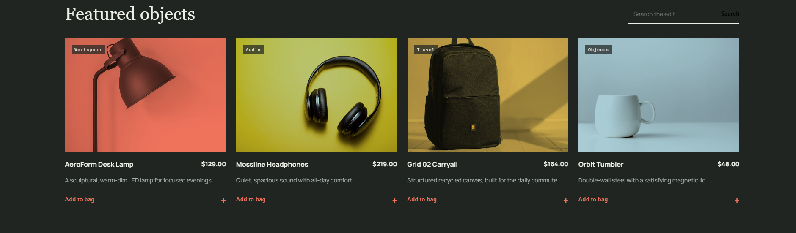
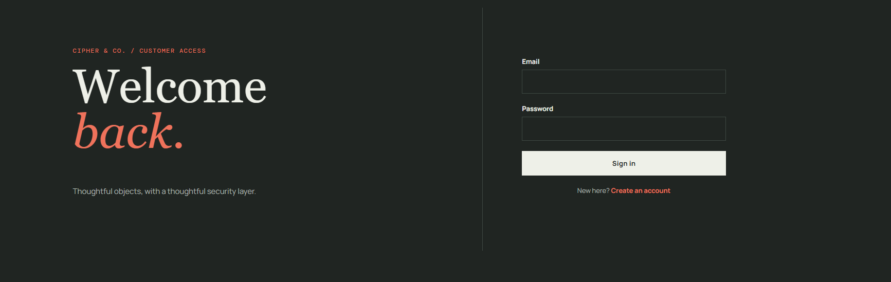
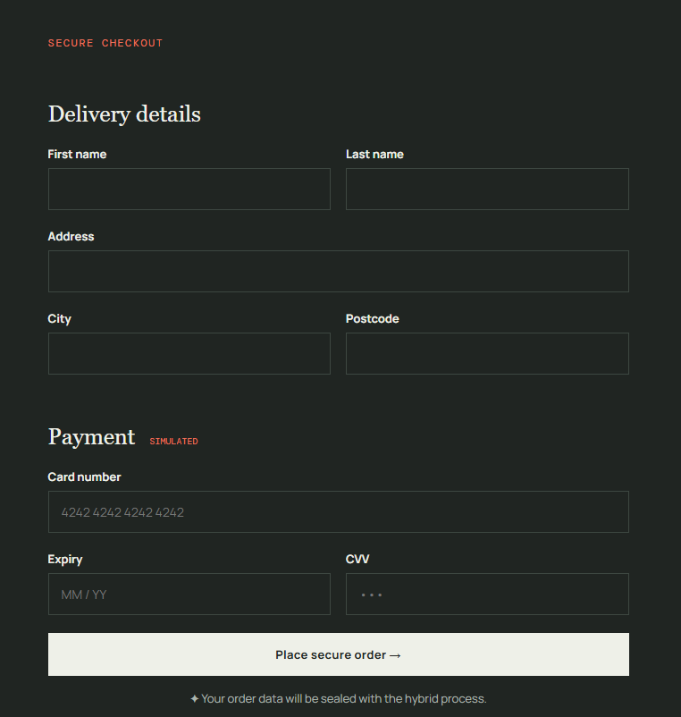
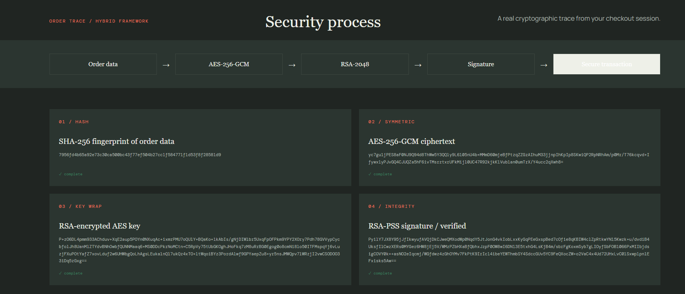
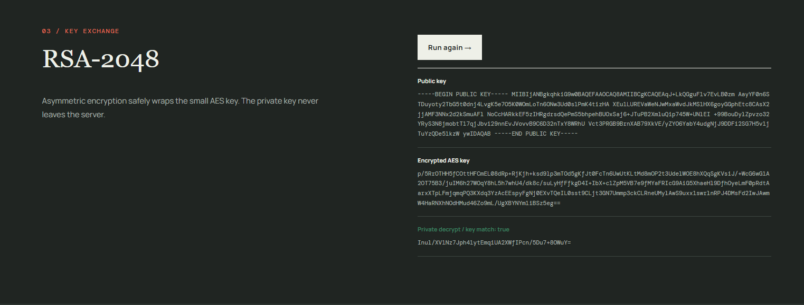
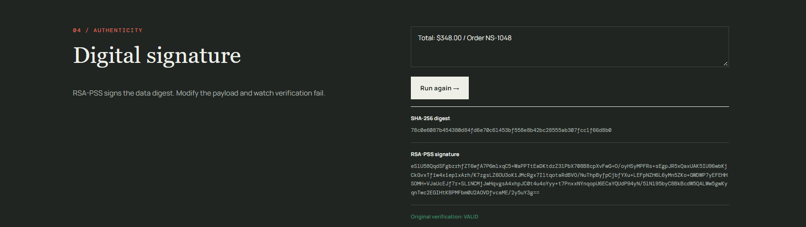

# Design and Implementation of a Hybrid Cryptographic Security Framework for a Secure E-Commerce Website

A customer-only Flask e-commerce reference application with a live, interactive Security Lab. The payment flow is simulated, while the cryptographic operations are real implementations from `cryptography`. SQLite is used for local persistence, so no database server is required.

## Features

- Customer registration, login, logout, profile, order history
- Product browsing, search, detail pages, session cart, checkout, confirmation
- Security Lab for SHA-256, AES-256-GCM, RSA-2048, RSA-PSS signatures, and the complete hybrid flow
- Checkout seals order JSON with AES-256-GCM, wraps the AES key with RSA-OAEP, signs the order with RSA-PSS, and stores the trace in the order record
- Security process page exposes hash, ciphertext, wrapped key, signature, and completion stages
- SQLite-backed users and orders in `secure_ecommerce.db`, with a demo product catalog

## Requirements

- Python 3.11+
- Python's built-in SQLite support

## Setup

```powershell
python -m venv .venv
.\.venv\Scripts\Activate.ps1
pip install -r requirements.txt
$env:FLASK_SECRET_KEY = "replace-with-a-long-random-secret"
python app.py
```

Open `http://127.0.0.1:5000`. Create a customer account, add an object to the bag, and use checkout. The account and lab routes require login. The simulated card accepts any non-empty value.

## SQLite Database schema

`users`: `{ id, name, email, password_hash, salt, created_at }`

`products`: `{ name, category, price, description, icon, accent, image }`

`orders`: `{ id, user_id, items, total, created_at, security }`

The app creates its SQLite tables automatically on startup. For production, add CSRF protection, secure cookie settings, rate limiting, key management/HSM support, and never persist private transaction keys as this reference implementation does for observability.

## Security choices

- Passwords: per-user random salt and scrypt-derived 256-bit hash
- Integrity: SHA-256 digest
- Bulk confidentiality and authenticated encryption: AES-256-GCM with a fresh key and 96-bit IV per operation
- Key exchange: fresh RSA-2048 key pair and RSA-OAEP with SHA-256
- Authenticity: RSA-PSS with SHA-256
- Hybrid design: AES handles order data, RSA wraps the AES key, and the signature authenticates the original order payload


## Security Disclaimer

CipherCo is an educational project developed to demonstrate the practical implementation of cryptographic techniques in an e-commerce environment. It showcases AES-256-GCM encryption, RSA-2048 key encryption, SHA-256 hashing, and digital signatures.

This application is intended for learning and demonstration purposes only. It is not a production-ready e-commerce or payment processing system. The checkout and transaction workflows are simulated and should not be used to process real payments or sensitive financial information.

Although the project demonstrates important security mechanisms, it has not undergone a comprehensive security audit or production-level testing. Additional security measures, testing, and infrastructure would be required before deployment in a real-world commercial environment.

# Screenshots

## 1. Featured Products Page


## 2. User Login Page


## 3. Secure Checkout Page


## 4. Security Process Overview


## 5. AES-256-GCM Encryption


## 6. RSA-2048 Key Exchange


## 7. Digital Signature Verification

